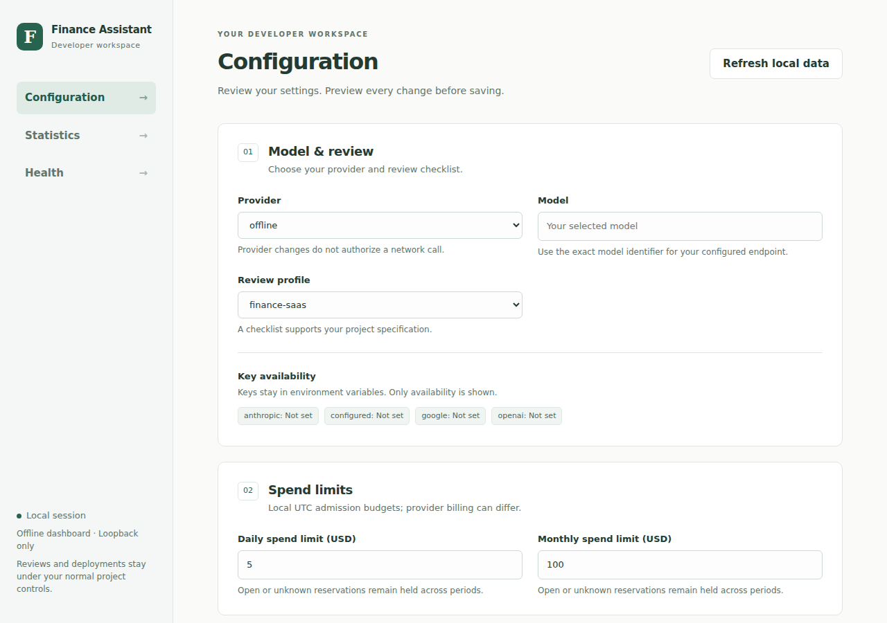
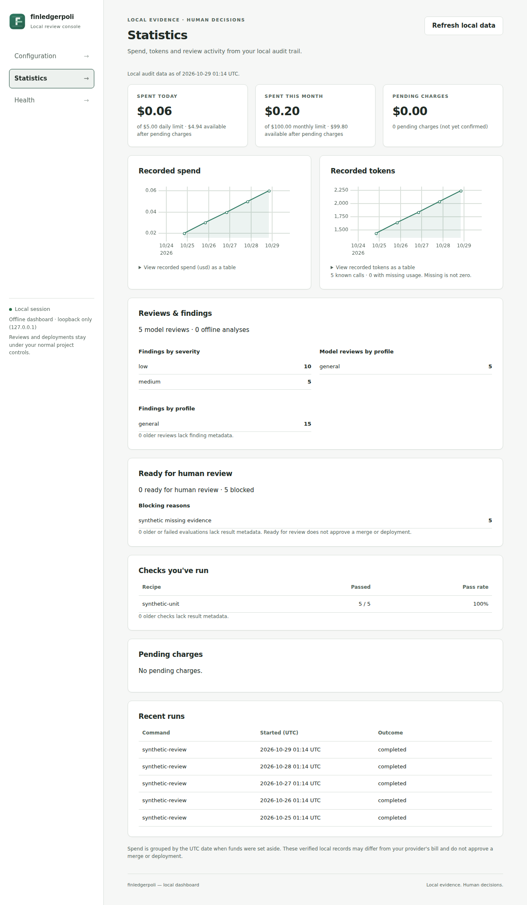
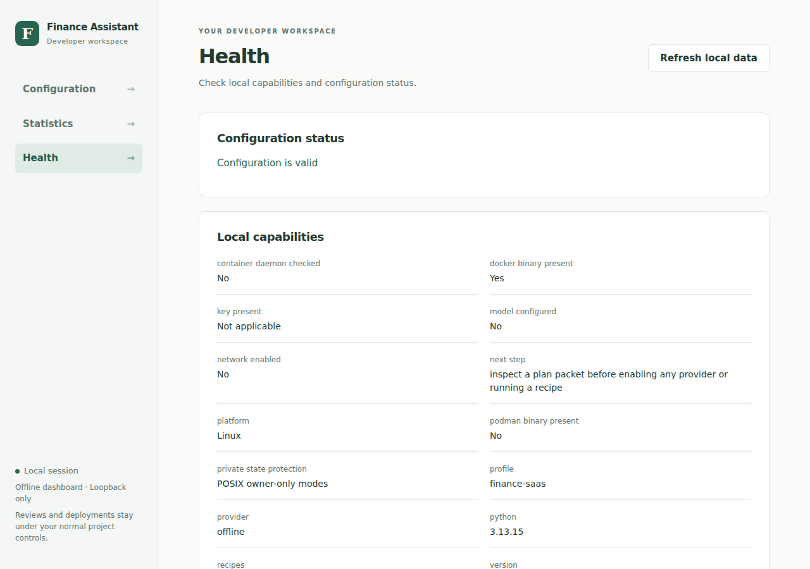

# Finance Developer Assistant

[](https://github.com/EleutheroiEdge/finance-dev-assistant/actions/workflows/ci.yml)
[](https://scorecard.dev/viewer/?uri=github.com/EleutheroiEdge/finance-dev-assistant)
[](LICENSE)
[](pyproject.toml)

Review committed changes, reproduce findings and inspect readiness evidence for
finance software, using your chosen model or deterministic offline analysis.

**Local-first, no telemetry.** The default provider is offline. The demo and local
dashboard make no external requests. Remote model reviews and GitHub inspection
require explicit configuration and approval. The dashboard ships prebuilt and
binds only to `127.0.0.1`; Node is needed only for frontend development.

## What it does

- **Review source:** freeze commits, screen paths/content, inspect coverage and
  use configurable finance, research, quant or custom review profiles.
- **Reproduce:** run approved recipes on screened snapshots in a pinned,
  network-disabled container; trusted local execution requires explicit opt-in.
- **Propose carefully:** inspect and approve exact patch hashes, protect policy
  files and preserve guarded recovery copies. No automatic merge, deploy or trade.
- **Track evidence:** local spend reservations, usage, findings, readiness and a
  tamper-evident audit trail; unknown outcomes stay visible and block readiness.
- **Configure locally:** preview a diff, confirm a save, inspect statistics and
  run Health checks from the browser. API keys stay in environment variables.

## Start in one minute

Python 3.11+ is required; Git is needed for source workflows. After the first PyPI
release is published, install the command with [pipx](https://pipx.pypa.io/):

```sh
pipx install finassist
finassist demo
finassist doctor
finassist init --output finassist.json
finassist --config finassist.json dashboard
```

Until publication, or to develop from source, clone and install instead:

```sh
git clone https://github.com/EleutheroiEdge/finance-dev-assistant.git
cd finance-dev-assistant
python3 -m venv .venv
.venv/bin/python -m pip install .
.venv/bin/finassist demo
.venv/bin/finassist init --output finassist.json
.venv/bin/finassist --config finassist.json dashboard
```

On Windows PowerShell, use `py -3 -m venv .venv`, then
`.\.venv\Scripts\python.exe -m pip install .` and
`.\.venv\Scripts\finassist.exe demo`. No activation or execution-policy change
is required. macOS/Linux use the commands above. See [platform setup](docs/platforms.md)
for UTF-8, permissions, Git modes and Docker Desktop details.

The demo uses fictional finance checks and needs no key, model download or
container. It demonstrates deterministic oracles, not model review quality.
[Download the short terminal recording](docs/images/demo.cast.txt) and play it locally
with `asciinema play docs/images/demo.cast.txt`; no hosting account is needed.

## Dashboard preview

These screenshots come from an isolated synthetic fixture. All displayed spend,
tokens, findings and review activity are fictional; no provider was called.



<details>
<summary>Statistics and Health screenshots</summary>





</details>

See the [dashboard guide](docs/dashboard.md) for configuration previews, explicit
confirmation, audit statistics and same-user security limits.

## Review your first change

After inspecting your configuration and source policy:

```sh
finassist --config finassist.json plan --repo . --base main --head HEAD \
  --output .finassist/context.json
finassist --config finassist.json review --packet .finassist/context.json \
  --output .finassist/offline-review.json
```

Offline analysis does not claim a model review or test execution. To use a remote
model, choose its provider/model/endpoint, price assumptions and named environment
variable; enable network access deliberately and approve the exact outgoing packet.
There is no automatic provider fallback. [Provider setup](docs/providers.md) explains
OpenAI Responses, Anthropic, Gemini, compatible Chat Completions and local Ollama.
Compatibility tests use fake transports; not every model/service is live-tested.

## Guides

| Goal | Guide |
| --- | --- |
| Adapt to your own team | [Fork and customize](docs/fork-and-customize.md) |
| Understand protection and limits | [Threat model](docs/threat-model.md), [security policy](SECURITY.md) |
| Configure profiles, paths and budgets | [All configuration options](docs/configuration.md), [examples](examples/) |
| Automate command results | [Exit codes and JSON contracts](docs/cli-contracts.md) |
| Plan, review, check and recover | [Workflow contracts](docs/workflows.md), [auditing/readiness](docs/readiness-and-auditing.md) |
| Evaluate findings or manage evidence | [Evaluation](docs/evaluation.md), [research inputs](docs/research-inputs.md) |
| Integrate your coding agent | [Portable templates](docs/integrations.md), [evidence-review skill](skills/evidence-review/SKILL.md) |
| Maintain and release a fork | [Repository settings](docs/repository-settings.md), [releasing](docs/releasing.md) |

Keep `.finassist/` and private artifacts out of Git. Inspect every outgoing packet:
content screening cannot prove confidentiality. A readiness result grants no merge,
deployment or financial authority. Local audit hashes cannot defeat a malicious
same-user rewrite; budget estimates are not provider-enforced billing caps.

## Contribute

```sh
python -m pip install -r requirements-dev.lock
python -m pip install --no-deps --no-build-isolation -e .
python -m pytest -q
ruff check src tests scripts
finassist demo
finassist scan --repo .
```

Use synthetic fixtures and fake provider transports. See [contributing](CONTRIBUTING.md),
[architecture](docs/architecture.md) and [media reproduction](docs/images/README.md).
Scorecard is a posture indicator, not certification; results appear after its
workflow publishes. The PyPI badge will be added after the owner verifies the first
public release. Forks must update badge/repository links and maintainer settings.

MIT licensed. See [LICENSE](LICENSE).
